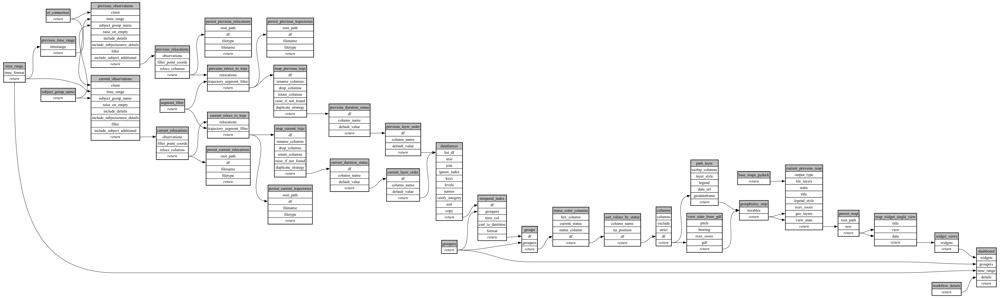

```
# AUTOGENERATED BY ECOSCOPE-WORKFLOWS; see fingerprint in README.md for details

```

```yaml
# fingerprint:
artifacts_sha256_basic: 4ee4d4ec979881193da88297cbf7971b5139b1927f86bda00d04a7337d56d3bf
artifacts_sha256_strict: 089a97b4127fb2dfd63e036b9867d06c2743ec1db692d29c09b6d5b27b8b19da
installed_requirements:
- channel: https://repo.prefix.dev/ecoscope-workflows/
  name: ecoscope-platform
  version: {version: ==2.25.3}
- channel: https://repo.prefix.dev/ecoscope-workflows-custom/
  name: ecoscope-workflows-ext-custom
  version: {version: ==0.1.4}
- channel: https://repo.prefix.dev/ecoscope-workflows-custom/
  name: ecoscope-workflows-ext-ste
  version: {version: ==0.0.24}
- channel: conda-forge
  name: pydeck
  version: {version: ==0.9.2}
params_sha256: 92b6d6bd50c18b1f6a7e1a36e1fa0b89d411f70cd38cb72e2253ee47746b2ada
spec_sha256: 4c9183f533c02689a626d70642f9ddeb503e811a822790327c00d6eacd5dfd5f

```

# ecoscope-workflows-subject-historic-current-comparison-workflow


