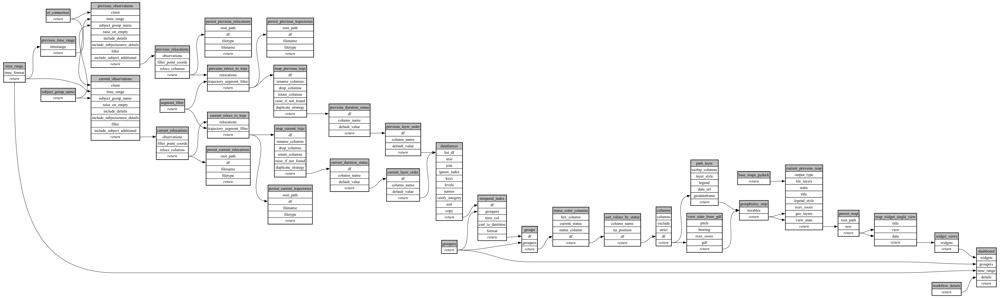

```
# AUTOGENERATED BY ECOSCOPE-WORKFLOWS; see fingerprint in README.md for details

```

```yaml
# fingerprint:
artifacts_sha256_basic: 99c07568463eff666e116cd6e9e4aa55ca3363c2a8c64dc46a15aaa283192a3c
artifacts_sha256_strict: 5f1cac45b51e5e0d077f5005a9becc28c5dc7deae587e45f8a778ecf8e6aef63
installed_requirements:
- channel: https://repo.prefix.dev/ecoscope-workflows/
  name: ecoscope-platform
  version: {version: ==2.25.3}
- channel: https://repo.prefix.dev/ecoscope-workflows-custom/
  name: ecoscope-workflows-ext-custom
  version: {version: ==0.1.4}
- channel: https://repo.prefix.dev/ecoscope-workflows-custom/
  name: ecoscope-workflows-ext-ste
  version: {version: ==0.0.24}
- channel: conda-forge
  name: pydeck
  version: {version: ==0.9.2}
params_sha256: 92b6d6bd50c18b1f6a7e1a36e1fa0b89d411f70cd38cb72e2253ee47746b2ada
spec_sha256: b8bee5e4a9e25539ce660d868a5edb6050df24a677e5205f9538a6f5b9535e33

```

# ecoscope-workflows-subject-tracking-current-historic-map-workflow


